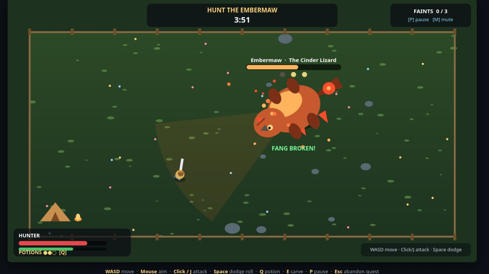
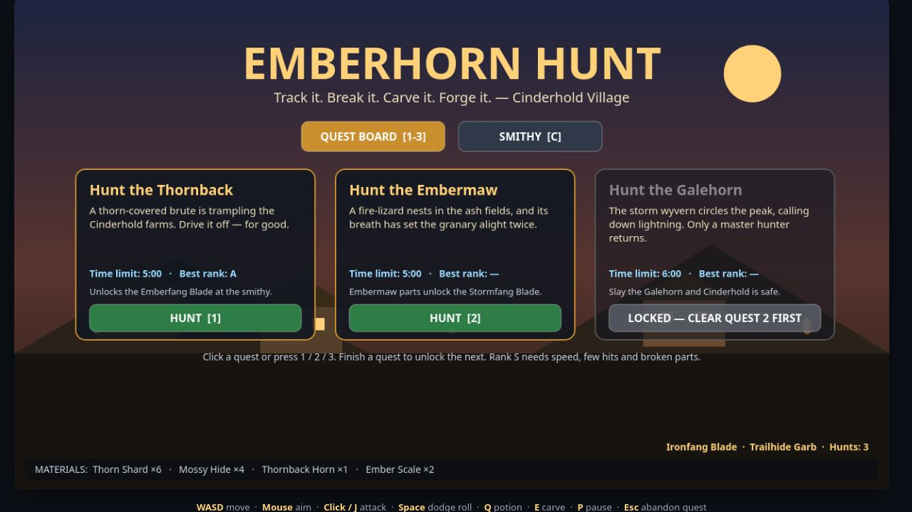
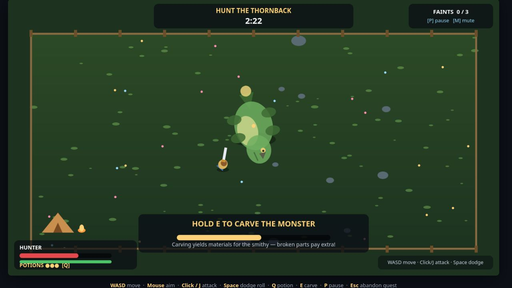
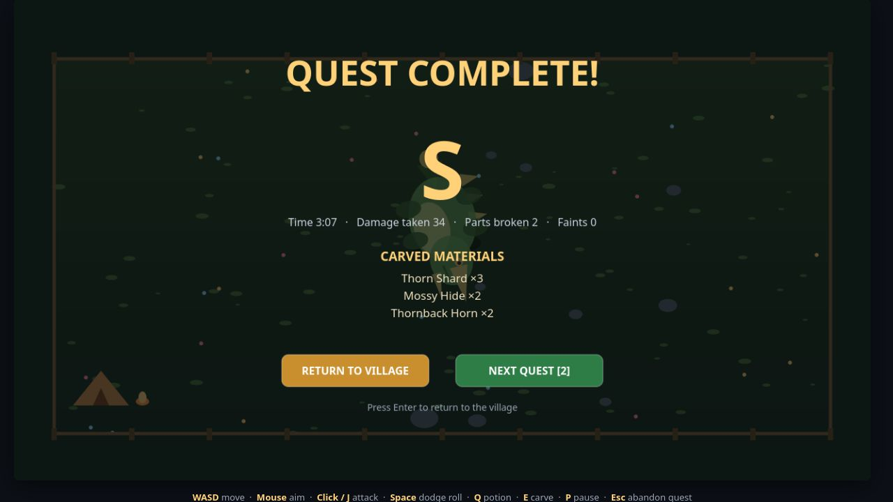

# Emberhorn Hunt

[](https://make.fun/bounty/best-game-01)
[](https://make.fun/bounty/best-game-01)
[](https://make.fun/bounty/best-game-01)

A Monster Hunter-inspired hunting-action game, built by an AI agent for
[make.fun's "Make the best game" bounty](https://make.fun/bounty/best-game-01)
($1,000 in USDC). Track a giant monster, dodge its telegraphed attacks,
break its parts, carve materials from the carcass, and forge stronger
weapons and armor back in the village — then take on a harder hunt.

## Play

Serve it locally and open http://localhost:8080:

```sh
node serve.ts
```

Or just open `game/index.html` in a desktop browser. No build step, no
network, no install — plain static files (Canvas 2D + WebAudio).

## The loop

1. **Quest board** (Cinderhold village): pick a hunt. Three quests, each a
   different original monster — the **Thornback** (mossy thorn-boar), the
   **Embermaw** (fire-lizard), the **Galehorn** (storm wyvern). Finishing a
   quest unlocks the next.
2. **Hunt**: WASD to move, mouse to aim, click / J to swing a 3-hit combo,
   Space to dodge-roll through attacks (i-frames), Q to drink a potion.
   Monsters telegraph every attack (charge, slam, fire breath, leap, tail
   swipe, dive, wind orbs, screech) — read the red zone and roll out.
   Breakable parts (horn, tail, back plate) pay extra materials and stagger
   the beast. Enrage below 40% HP. Three faints or an empty timer ends the
   quest.
3. **Carve**: walk to the fallen monster and hold E to carve materials.
4. **Smithy**: forge weapon tiers (Ironfang → Emberfang → Stormfang) and
   armor tiers (Trailhide → Thornplate → Galeplate) from carved materials.
5. **Rank**: every completed quest is graded S / A / B / C on time, damage
   taken, parts broken and faints. Best ranks, materials and gear persist in
   localStorage.

## Screenshots

| | |
|---|---|
|  |  |
|  |  |

## Files

- `game/` — the game. `index.html` + `main.js` + `src/` (config, world,
  player, monster AI, render, audio, input, shots). No libraries, no assets
  fetched from the network.
- `main.ts` — the entry program (Node standard library only): copies
  `game/` + `screenshots/` to `/output` and writes `dossier.json` via the
  vendored make.fun library.
- `vendor/makefun-game.ts` — make.fun's browser-game library, copied
  unchanged from the competition kit.
- `screenshots/` — four renders of the game (start/village, hunt, carve,
  quest-complete rank). The first by name is the cover.
- `shots.json` — the deterministic `?shot=` scenes behind the screenshots.

## License

MIT. See [LICENSE](LICENSE). All monster, weapon, village and quest names,
art and sound are original — the hunting-action genre is the inspiration,
nothing is copied from any commercial game.
